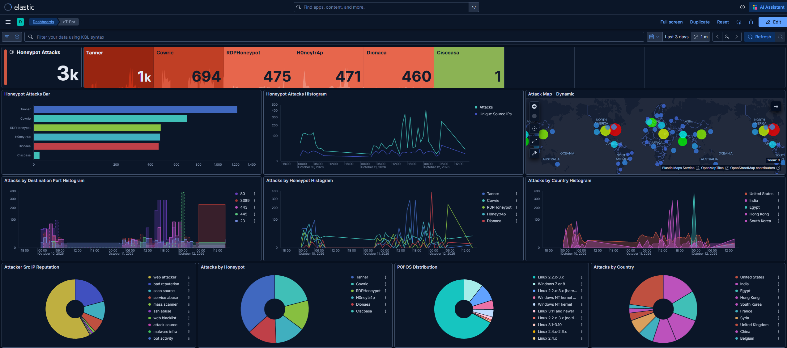
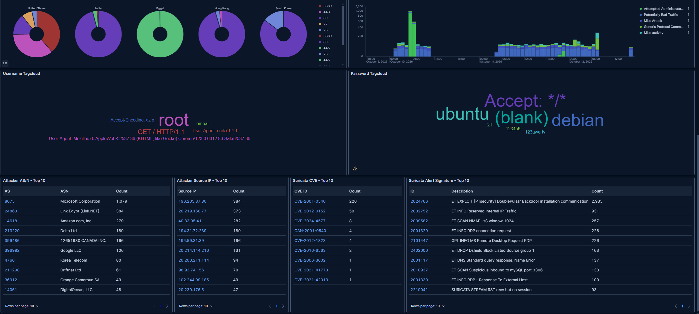

# T-Pot-Deployment-on-AWS-Personal-Project
This project is designed to deploy a T-Pot honeypot on an AWS ubuntu server. The goal of this project is to see real world data and attacks in real time.

For this project, I used a personal Ubuntu Server, as well as an Amazon AWS Instance in order to deploy my Honeypot.
I started first with deploying the AWS EC2 Instance, this instance would allow me to keep my home devices safe from any potential issues that may arise. We make sure that in order to access the server we setup a key file, so that the instance can only be accessed from machines with that Key. Creating an extra layer of security for the Ubuntu Server. To start, the only port that should be open is the Home port to access the server.

Once we are inside our AWS instance, we can install our honey pot using https://github.com/telekom-security/tpotce, this honeypot is an open source platform that we will use to collect attakcs. Once installed we can now change our AWS instance to accept multiple different port numbers to subject our honey pot to outside traffic. Allowing certain ports of different types to access the honeypot is what we will use to collect actual data.

Now that we can access our Honeypot menu, we can see the different types of data

This T-Pot honeypot dashboard (Kibana, October 10-12, 2026) recorded roughly 3,000 attacks across six honeypots. Tanner, the web application honeypot, was hit most (about 1,000), followed by Cowrie (SSH/Telnet, 694), RDPHoneypot (475), H0neytr4p (471), Dionaea (460), and Ciscoasa (1). The most targeted ports were 80, 3389, 443, 445, and 23, showing that web, remote access, and file-sharing services draw the most attention. Traffic was low and steady for most of the period, with large bursts on October 11-12 that point to automated scanning or botnet activity. Attacks came from around the world, led by the United States, India, Egypt, Hong Kong, and South Korea, and most source IPs were flagged as web attackers, mass scanners, or otherwise having a bad reputation. Attacker systems were mostly Linux, with some Windows, likely compromised servers or IoT devices. Overall, exposed services are probed constantly, and most of this activity appears opportunistic and automated.

Like the top half of the data, the bottom half shows us some interesting information. The lower half of the dashboard covers attacker infrastructure, credentials, and Suricata detections. Targeted ports varied by country: the United States and Hong Kong showed a mix including 3389 and 80, while India, Egypt, and South Korea were dominated by a single port each. Suricata alerts were categorized mostly as attempted administrator privilege gain, potentially bad traffic, and misc attacks, with a large spike of roughly 1,000 events early on October 10. The captured credentials were typical of automated brute-forcing: “root” dominated the usernames, while passwords included “ubuntu”, “debian”, blank entries, “123456”, and “123qwerty”, alongside many HTTP header strings (such as curl and Chrome user agents) picked up by the web honeypots. Microsoft (AS8075) was the top source network with about 1,079 events, followed by Link Egypt, Amazon, Delta Ltd, and others, and the top source IPs included 196.205.87.80 (384), 20.219.160.77 (373), and 40.83.95.41 (282), with several belonging to Microsoft Azure ranges. The most frequent Suricata signature by far was the DoublePulsar backdoor communication alert (2,935), followed by reserved internal IP traffic, Nmap scans, and RDP connection requests, and the most common CVEs were CVE-2001-0540 (226, an old RDP memory leak vulnerability) and CVE-2012-0152 (59, another RDP flaw). Overall, the data shows opportunistic scanning and default-credential guessing, heavily focused on RDP and SMB, and largely originating from cloud provider infrastructure.

## Conclusion

Although these attacks were not targeted at anyone in particular, they are the same common tactics attackers use to try to gain access to any exposed system. Today, tools like AI make it even easier for anyone to build automated software that guesses credentials and scans cloud servers. Over just three days, the honeypot recorded roughly 3,000 attacks from countries all over the world, showing that even a small project on a cloud server can be probed internationally within hours of going online. The server stayed secure for several reasons. Access required a private key file, which was stored on a separate server that was not actively connected to the AWS instance, so guessing passwords alone could never get an attacker in. Overall, this project showed me the basic attacks any system can face. It also taught me the fundamentals of cloud computing with AWS, building a secure server, connecting multiple servers, key configuration, and system isolation.